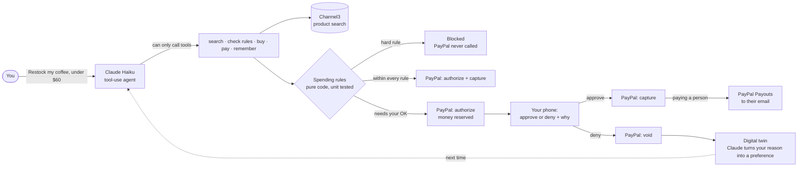

# Leash

**Your AI assistant can spend. Your rules decide what money moves.**

AI agents read untrusted text: product pages, emails, messages. One hidden sentence can tell an agent to buy gift
cards or pay a stranger. That's why nobody hands an AI their PayPal today.

Leash lets Claude shop and pay with your PayPal for the boring parts of running a home: restocking coffee and dog
food, paying the babysitter, settling dinner with a roommate. Claude chooses, but **code decides whether money
moves**. Anything outside your rules is **reserved, not taken** (a PayPal authorization) until you say yes on your
phone. Say no, and PayPal releases it: you're never charged. Leash also learns from every yes, no and refund, like a
digital twin.

## For judges: a 60-second test

1. Open the live demo (link in the Devpost submission) and click **Reset demo** (bottom left) for a clean start.
   PayPal is already connected to a sandbox account, so you don't need to log in to anything.
2. A grinder is already **waiting for you**: PayPal has reserved the money but not taken it. Scan its QR code (or
   click it) and tap **Deny**. Say why, in your own words. PayPal voids the reservation, and the screen shows what
   your twin learned.
3. On **Assistant**, click **"Restock my coffee setup, under $60…"**. Watch Claude search real stores (Channel3),
   check your rules and pay. Anything within your rules is paid; anything over your $50 limit is held.
4. Click **Try to break the leash** and pick an attack. A scam "takes over" the assistant, and the rules stop the
   money anyway.
5. Click **"Pay Sam $25 for dinner"**. PayPal takes the money from your account and **Payouts** sends it on to Sam.
6. Open **Control room** and ask a question in plain English, e.g. _"what did I spend on coffee this week?"_.
   Click any row to see each PayPal step with its id.

Everyone shares one demo account. It resets every night, and on its own when someone arrives after 20 quiet
minutes. Resetting releases every open PayPal reservation first.

## How the money moves

| Your rules say                                             | PayPal does                     | You see                                        |
| ---------------------------------------------------------- | ------------------------------- | ---------------------------------------------- |
| Within every rule                                          | authorize, then capture         | Paid automatically                             |
| Over a limit or budget, someone new, or not what you asked | authorize and **hold**          | Waiting for you: approve or deny on your phone |
| You deny                                                   | **void** the authorization      | Denied, never charged. Your twin remembers.    |
| Blocked category, merchant, cap or hard limit              | nothing; PayPal is never called | Blocked by rules                               |
| You refund a purchase                                      | refund the capture              | Refunded. Your twin remembers.                 |
| Paying a person, once the money is taken                   | **Payouts** to their email      | Sent on to Sam's PayPal                        |

You connect your PayPal account once with **PayPal Vault**. After that the assistant pays with the saved account,
so there is no PayPal popup for every purchase, and the authorize-then-capture flow is what makes "held" possible.

A saved PayPal account can only pay the app that saved it. So paying Sam is two PayPal steps: your account pays
Leash (reserved, then captured, exactly like a purchase), and Leash sends the same amount straight on to Sam's
email with **PayPal Payouts**. If the payout fails, the capture is refunded at once. If Sam has no PayPal account,
PayPal emails Sam a link to claim it.

### What's real and what's simulated

| Real                                                                                                           | Simulated                                                                                     |
| -------------------------------------------------------------------------------------------------------------- | --------------------------------------------------------------------------------------------- |
| Every PayPal call (sandbox): Vault, Orders, authorize, capture, void, refund, Payouts, webhooks                | One sandbox business account stands in for every store you buy from                           |
| Claude Haiku choosing products and payments with tools, and turning your words into lessons, filters and rules | The attacks are scripted, and skip the AI on purpose, so only the rules stand in the way      |
| Channel3 product search across real online stores, with real photos and prices                                 | The history you see on first open is sample data. It has no PayPal ids, and can't be refunded |
| Supabase storage and live updates                                                                              |                                                                                               |

## How it fits together



Claude decides _what_ to buy. Code decides _whether money moves_: every purchase and payment goes through one
function, `server/spending/spending-service.ts`, which applies the rules, calls PayPal, saves the decision and
teaches the twin, in that order, every time.

**Why Claude doesn't get PayPal's own AI tools.** PayPal's Agent Toolkit and MCP server give a model tools like
`create_order` and `capture_order`. That makes the model the last line of defence: one injected sentence, and it
calls them. Leash gives Claude intent-level tools instead ("buy this product", "pay Sam $25, because…"), and keeps
PayPal behind one rule-checked function the model can't skip, change or see the keys for.

## What it can do

- **Shop like you.** Claude searches real products (Channel3), explains every pick, and avoids things you've said
  no to before.
- **Pay people.** "Pay Sam $25 for dinner." Trusted people are paid within your limits, through PayPal Payouts;
  anyone new waits for you, and so does anyone without a PayPal email yet.
- **Learn your taste.** Deny an $85 grinder and next time it picks the $34 one, and says why. The twin page shows
  everything it has learned, and you can teach it or make it forget.
- **Restock on a schedule.** "Restock dog food every 30 days." A daily job runs what's due. You aren't there to
  watch, so everything a restock buys waits for your OK.
- **Approve from your phone.** Anything held shows a QR code. Scan it, approve or deny, and the desktop updates live.
- **Ask why, and learn it.** When you deny, say why: "too expensive", "wrong store", or your own words like "I only
  want hand grinders". Claude turns it into a precise preference, and the twin applies it next time.
- **Stay on what you asked for.** Ask for coffee, and anything that isn't coffee waits for you, however cheap. A
  hijacked assistant can't slip extra items into your order one small buy at a time.
- **Survive a hijack.** "Try to break the leash" plays three scams against the assistant: $900 to a stranger, gift
  cards from a poisoned product page, and extra items hidden in your coffee order. They skip the AI entirely, so
  only the rules stand in the way, and they hold. The stranger doesn't even end up on your people list.
- **Show everything.** The AG Grid control room lists every decision live, with the rule that applied, the AI's
  reasoning, the PayPal status and `debug_id`, and approve, deny and refund buttons. Ask it questions in plain
  English ("held payments over $20, biggest first"): Claude turns them into grid filters and sorting, and the totals
  row adds up exactly what you see. Click a row to see each PayPal step with its id.
- **Rules in your own words.** "Ask me before anything over $30, and no snacks." Claude suggests the change, you see
  each difference, and nothing is saved until you confirm.
- **Never leave money stuck.** A reservation nobody answers is released after 7 days by the daily job.

## Run it locally (no keys needed)

Requires Node.js 22+.

```bash
npm install
cp .env.example .env.local   # optional: every service has a mock mode
npm run dev
```

Open http://localhost:3000 and try **"I need a coffee grinder"**. Approve or deny it under "Waiting for you",
then ask again and watch the assistant choose differently. The sidebar shows which services are live and which
are mocked.

## Turning on the real services

Each service switches from mock to real as soon as its keys are in `.env.local`. Add them in any order.

| Service                        | Keys                                                                                     | Where to get them                                                                                                                                                                                         |
| ------------------------------ | ---------------------------------------------------------------------------------------- | --------------------------------------------------------------------------------------------------------------------------------------------------------------------------------------------------------- |
| **PayPal sandbox**             | `PAYPAL_CLIENT_ID`, `PAYPAL_CLIENT_SECRET`, `NEXT_PUBLIC_PAYPAL_CLIENT_ID`               | developer.paypal.com > Apps & Credentials > Sandbox > Create App. Turn on **Save payment methods** and **Payouts**. Then open **Connect PayPal** in the app and log in with a sandbox _personal_ account. |
| PayPal webhooks (optional)     | `PAYPAL_WEBHOOK_ID`                                                                      | In the same app, add a webhook pointing at `https://<your-app>/api/paypal/webhook` for the `PAYMENT.AUTHORIZATION.*` and `PAYMENT.CAPTURE.*` events.                                                      |
| **Claude** (the assistant)     | `ANTHROPIC_API_KEY`                                                                      | console.anthropic.com. Uses Claude Haiku: a whole demo costs about a dollar.                                                                                                                              |
| **Channel3** (product search)  | `CHANNEL3_API_KEY`                                                                       | channel3.ai                                                                                                                                                                                               |
| **Supabase** (database + live) | `NEXT_PUBLIC_SUPABASE_URL`, `NEXT_PUBLIC_SUPABASE_ANON_KEY`, `SUPABASE_SERVICE_ROLE_KEY` | Create a project, open the SQL editor and run `supabase/migrations/20261106000000_initial_schema.sql`. The app adds sample data on first start.                                                           |
| Daily job                      | `CRON_SECRET`                                                                            | Any long random text.                                                                                                                                                                                     |
| Public demo                    | `DEMO_MODE=true`                                                                         | For a shared demo: adds **Reset demo**, resets every night, hides **Disconnect**, and caps Claude use per visitor (the built-in assistant takes over past the cap).                                       |

Payments to people use PayPal Payouts, which works with any email. To watch one arrive, set the person's email on
the **People** page to a sandbox personal account (developer.paypal.com > Sandbox accounts) and log in to it at
sandbox.paypal.com.

To show a declined card in a demo, set `DEMO_FORCE_DECLINE=true`. PayPal's sandbox then declines every capture
(`INSTRUMENT_DECLINED`) and the control room shows the failure with its `debug_id`.

## Deploy on Render

`render.yaml` describes everything. In the Render dashboard choose **New > Blueprint**, pick this repository, and
fill in the keys you have (leave the rest blank for mock mode). It creates:

- **leash**: the web app
- **leash-daily**: a cron job that calls `/api/keepalive` once a day, to keep the database awake and run due
  restocks

After the first deploy, set `APP_URL` to the app's address (e.g. `https://leash.onrender.com`). Use a paid
instance for a public demo: the free one sleeps when idle and takes up to a minute to wake. Connect Supabase too,
because memory mode forgets the connected PayPal account whenever the app restarts.

## Checks

```bash
npm run check   # type check, lint, unit tests
npm run build   # production build
npm run smoke   # end-to-end demo story; start the app with `ANTHROPIC_API_KEY= npm run dev` first
```

The smoke test uses the scripted assistant, because Claude's choices vary. With `ANTHROPIC_API_KEY` set, the
assistant runs on Claude: it chooses the tools itself, but it can only act through them, so every purchase and
payment still passes the spending rules. If Claude can't be reached, the scripted assistant takes over.

## Project structure

```
src/
  app/          Pages and API routes (thin)
  components/   UI, grouped by screen
  lib/          Browser helpers: API client, formatting, labels
  schemas/      Every kind of data, defined once with zod
  server/
    agent/      The assistant (Claude + a scripted fallback) and its tools
    database/   One file per table, in a memory version and a Supabase version
    payments/   PayPal: authorize, capture, void, refund, Payouts, Vault, webhooks
    products/   Product search: Channel3 and a sample catalog
    restocks/   Recurring restocks and the daily job
    spending/   Rule engine and the money path
    twin/       Learning your preferences
supabase/migrations/   Database schema (SQL)
render.yaml            Render deployment
```

See [docs/CONVENTIONS.md](docs/CONVENTIONS.md) for the rules every change follows.

## Built with

- **PayPal**: Orders v2 (authorize), Payments v2 (capture, void, refund), Vault v3 (saved payment method),
  Payouts v1 (paying people), webhooks and negative testing, through `@paypal/paypal-server-sdk` and the REST API
- **Claude** (Anthropic): Claude Haiku, through `@anthropic-ai/sdk`. Tool use for the assistant, and structured
  outputs (checked with zod) for the twin's lessons, control room questions and rules in your own words
- **Channel3**: product search API
- **Supabase**: Postgres and Realtime
- **AG Grid Community**: the control room grid: external filters and sorting set by Claude, quick filter, a pinned
  totals row for the rows shown, cell flashing on live updates, and row selection for the PayPal step-by-step view
- **Render**: hosting and the daily cron job
- Next.js 16, React 19, TypeScript, zod, Tailwind CSS, Vitest, lucide icons

## License

MIT
